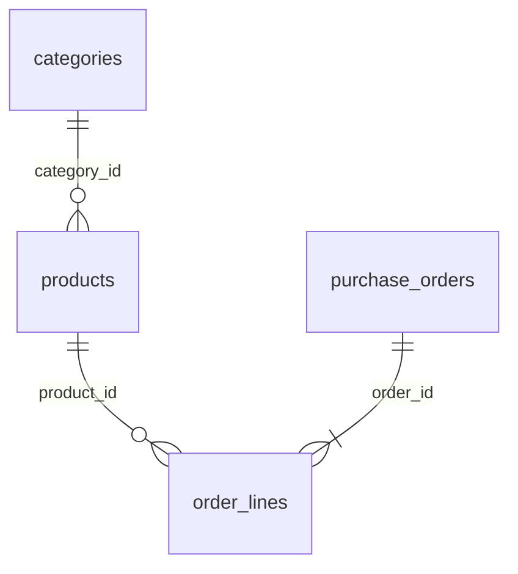

# Интернет-магазин Study Shop

Учебный REST-сервис магазина канцелярии и электроники. Он ведёт каталог, ищет товары по названию, обновляет цены и остатки, оформляет заказы и хранит историю покупки. При оформлении сервис проверяет наличие товара и списывает остатки. Цена и название каждой позиции сохраняются в заказе, поэтому изменения каталога не меняют историю.

Проект использует слоистую структуру [шаблона практики ГУУ](https://gitverse.ru/rdblkv/guu-practice-template). Стек этой сборки — Java 17, Maven, Spring Boot 3.5.5, Spring MVC, Bean Validation, Spring Data JPA, Hibernate и файловая H2. Для локальной демонстрации достаточно JDK и Maven. H2 запускается внутри приложения и сохраняет данные в папке `data/`.

## Сборка и запуск

Из корня проекта выполните:

```bash
java -version
mvn -version
mvn clean package
java -jar target/shop-java-study-1.0.0.jar
```

Maven должен использовать JDK 17 или новее. Сборка запускает тесты и создаёт исполняемый JAR. При первой сборке Maven загружает зависимости из Maven Central. Для запуска из исходников подходит `mvn spring-boot:run`, а в IDE — класс `ru.rostislav.shop.ShopApplication`.

Сервис доступен по адресу `http://127.0.0.1:8080`. Первый запуск создаёт категории «Канцелярия», «Электроника» и три демонстрационных товара. При повторном запуске с той же БД товары и заказы сохраняются. Остановить приложение можно через Ctrl+C.

Для чистой демонстрации запустите JAR с отдельной базой в памяти:

```bash
java -jar target/shop-java-study-1.0.0.jar '--spring.datasource.url=jdbc:h2:mem:defense' --spring.jpa.hibernate.ddl-auto=create-drop
```

Эта база живёт до остановки приложения. Для другого порта добавьте `--server.port=8081` и измените адрес в запросах. Параметр `--shop.demo-data.enabled=false` отключает первоначальное заполнение. Категории поставляются как готовый справочник. Развёртывание рассчитано на локальную учебную демонстрацию.

## HTTP API

| Метод и путь | Что делает | Успех |
| --- | --- | --- |
| `GET /api/categories` | Получает список категорий | `200 OK` |
| `GET /api/products` | Получает активные товары. Необязательный `q` ищет подстроку названия без учёта регистра | `200 OK` |
| `GET /api/products/{id}` | Получает активный товар | `200 OK` |
| `POST /api/products` | Создаёт товар из полей `name`, `price`, `stock`, `categoryId` | `201 Created` и `Location` |
| `PUT /api/products/{id}` | Заменяет все четыре редактируемых поля товара | `200 OK` |
| `PATCH /api/products/{id}` | Устанавливает абсолютный остаток. Тело `{"stock":15}` | `200 OK` |
| `DELETE /api/products/{id}` | Архивирует товар и скрывает его из каталога | `204 No Content` |
| `POST /api/orders` | Оформляет заказ из полей `customerName`, `customerEmail`, `items` и списывает остатки | `201 Created` и `Location` |
| `GET /api/orders/{id}` | Возвращает оформленный заказ с позициями и полной суммой | `200 OK` |

- `400 Bad Request` — поля не прошли проверку (`VALIDATION_ERROR`), JSON не соответствует ожидаемой структуре (`INVALID_JSON`) или некорректен ID в пути (`INVALID_PARAMETER`).
- `404 Not Found` / `NOT_FOUND` — указан неизвестный товар, заказ или категория. Архивный товар недоступен для чтения, редактирования и заказа. Повторный `DELETE` существующей архивной записи возвращает `204`.
- `409 Conflict` / `INSUFFICIENT_STOCK` — запрошенное количество превышает остаток. Остатки всех товаров из запроса сохраняют прежние значения.

Ошибки контроллера имеют поля `code`, `message` и `details`. Для запросов с телом передавайте `Content-Type: application/json`. Цена задаётся в рублях, максимум два знака после точки. Заказ содержит от 1 до 50 входных строк и от 1 до 10 000 единиц в каждой строке. Повторные строки одного товара складываются. Идентификатор создаёт база. В заказ клиент передаёт ID товара и количество, а сервис берёт цену из каталога.

## Сценарий показа на защите

Запустите приложение с чистой демонстрационной БД и выполните команды в другом терминале. Если работаете с ранее заполненной БД, посмотрите актуальные ID, цены и остатки через GET.

```bash
BASE=http://127.0.0.1:8080
curl -sS "$BASE/api/categories"
curl -sS "$BASE/api/products"
curl -sS -G --data-urlencode 'q=БЛОКНОТ' "$BASE/api/products"
```

Оформите заказ. Первая и последняя строки относятся к одному товару. После объединения получается 3 блокнота и 1 карандаш. Ответ возвращает `201`, заголовок `Location: /api/orders/1` и сумму `635.50` рубля. Остаток блокнотов меняется с 12 до 9, а карандашей с 20 до 19.

```bash
curl -i -sS "$BASE/api/orders" -H 'Content-Type: application/json' -d '{
  "customerName":"Анна",
  "customerEmail":"anna@example.test",
  "items":[{"productId":1,"quantity":1},{"productId":2,"quantity":1},{"productId":1,"quantity":2}]
}'
curl -sS "$BASE/api/products/1"
```

Запросите один блокнот и 100 карандашей. Блокнот обрабатывается первым по ID, затем возникает конфликт по карандашам. Ответ получит код `409`, и остаток блокнотов останется 9.

```bash
curl -i -sS "$BASE/api/orders" -H 'Content-Type: application/json' -d '{
  "customerName":"Анна",
  "customerEmail":"anna@example.test",
  "items":[{"productId":1,"quantity":1},{"productId":2,"quantity":100}]
}'
curl -sS "$BASE/api/products/1"
```

Покажите частичное и полное изменение товара, а затем архив. Используйте путь заказа из заголовка `Location`, если его номер отличается от 1.

```bash
curl -i -sS -X PATCH "$BASE/api/products/1" -H 'Content-Type: application/json' -d '{"stock":15}'
curl -i -sS -X PUT "$BASE/api/products/1" -H 'Content-Type: application/json' \
  -d '{"name":"Блокнот A5 новый","price":210.00,"stock":15,"categoryId":1}'
curl -i -sS -X DELETE "$BASE/api/products/1"
curl -i -sS "$BASE/api/products/1"
curl -i -sS "$BASE/api/orders/1"
```

Карточка архивного товара вернёт `404`. Заказ по-прежнему покажет «Блокнот A5» по 180.00 рубля и сумму 635.50. Для демонстрации создания товара используйте:

```bash
curl -i -sS "$BASE/api/products" -H 'Content-Type: application/json' \
  -d '{"name":"Тетрадь","price":52.90,"stock":6,"categoryId":1}'
```

## Как устроен проект

Запрос проходит по цепочке **Controller → Service → Repository → H2**. Spring MVC выбирает обработчик и преобразует JSON в DTO. Сервис управляет транзакцией и применяет правила предметной области. Репозиторий читает или сохраняет сущности, Hibernate формирует SQL. Сервис преобразует сущности в DTO до завершения транзакции. Контроллер передаёт ответ Spring MVC для сериализации в JSON.

Основной код находится в `src/main/java/ru/rostislav/shop`.

| Файл или пакет | Ответственность |
| --- | --- |
| `ShopApplication` | Запускает Spring Boot. Базовый пакет определяет область поиска компонентов и сущностей. |
| `service/DemoData` | При старте новой БД в одной транзакции создаёт справочник и стартовые товары. Проверка справочника позволяет сохранить изменения между запусками. |
| `controller/CategoryController` | Даёт HTTP-доступ к справочнику. |
| `controller/ProductController` | Принимает параметры поиска, ID и данные CRUD, формирует статусы и `Location`. |
| `controller/OrderController` | Принимает оформление заказа и выдаёт заказ по ID. |
| `exception/ApiExceptionHandler`, `model/dto/ApiError` | Преобразуют ошибки предметной области, валидации и чтения JSON в HTTP-ответы. |
| `service/CategoryService` | Получает категории и превращает их в DTO. |
| `service/ProductService` | Выполняет поиск и CRUD каталога. Проверяет категорию, доступность товара и получает блокировку на запись. |
| `service/OrderService` | Сводит количества по ID, списывает остатки, сохраняет заказ и возвращает итог. |
| `repository/CategoryRepository`, `OrderRepository` | Используют стандартные JPA-операции поиска и сохранения. |
| `repository/ProductRepository` | Читает активный каталог с категориями, блокирует строку товара перед изменением. |
| `model/entity/Category` | Хранит идентификатор и название справочной категории. |
| `model/entity/Product` | Хранит цену, остаток, категорию и признак архива. Управляет списанием и изменением каталожных полей. |
| `model/entity/PurchaseOrder` | Хранит покупателя, момент оформления и позиции. Добавляет позиции и рассчитывает сумму. |
| `model/entity/OrderLine` | Хранит ссылку на товар и заказ, количество, снимки названия и цены. Считает стоимость позиции. |
| `model/dto/ProductData`, `StockUpdate`, `OrderRequest` | Описывают и проверяют поля входных запросов. |
| `model/dto/CategoryView`, `ProductView`, `OrderView` | Описывают JSON-ответы, преобразуют сущности и позиции в данные для клиента. |
| `exception/ShopException`, `ResourceNotFoundException`, `StockConflictException` | Описывают ожидаемые ошибки, их код и пояснение. |
| `src/main/resources/application.yaml` | Настраивает локальный сервер, файловую H2, Hibernate и чтение JSON. |
| `src/test/java/ru/rostislav/shop/ShopApiTest.java` | Проверяет API через MockMvc с настоящей H2 в памяти. |
| `pom.xml` | Задаёт зависимости, версию языка и сборку исполняемого JAR. |
| `docs/Защита проекта.docx` | Содержит ответы на все 11 вопросов с примерами из кода. |

### Схема данных



Каждая позиция относится к одному заказу и одному товару. Заказ содержит как минимум одну позицию по правилам API. Пара `order_id` и `product_id` уникальна в таблице позиций. Цена единицы хранится в `DECIMAL(12,2)` и обрабатывается через `BigDecimal`. Сумма заказа рассчитывается из сохранённых позиций при чтении или оформлении.

### Транзакция заказа

1. `OrderService.placeOrder` объединяет повторные ID в `TreeMap<Long, Integer>`. Обход по возрастанию ID задаёт единый порядок блокировок при покупке нескольких товаров.
2. Для каждого ID `ProductService.lockActive` читает строку товара через `ProductRepository.lockById`. Блокировка записи удерживается до конца транзакции. Операции PUT, PATCH и DELETE используют тот же способ блокировки.
3. `Product.deductStock` проверяет количество и списывает остаток. `PurchaseOrder.addLine` создаёт позицию с текущей ценой и названием.
4. `OrderRepository.save` сохраняет заказ и каскадно его позиции. Hibernate обнаруживает изменения загруженных товаров и записывает остатки при завершении транзакции.
5. При исключении транзакция откатывается, включая списания по предыдущим позициям. После успешной фиксации контроллер возвращает заказ с кодом 201.

### Проверки и Javadoc

Команда `mvn test` запускает шесть интеграционных тестов. Они проверяют CRUD и поиск, объединение одинаковых товаров, сохранение истории после смены цены и архивации, откат остатков, две покупки последней единицы и ответы на ошибочные запросы. Тестовая БД в памяти независима от `data/shop.mv.db`.

Javadoc в исходниках описывает назначение типов и методов, параметры, результат и значимые исключения. Генерация HTML средствами JDK после сборки:

```bash
./scripts/javadoc.sh
```

Откройте `target/javadoc/index.html`.
